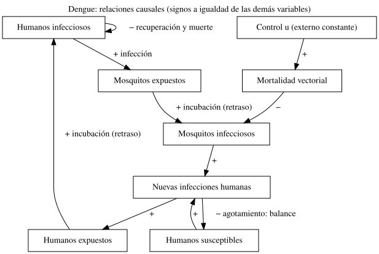
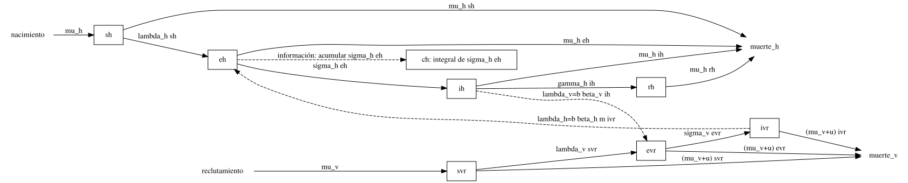

# Modelo causal y dinámico

El modelo representa un SEIR humano y un SEI vectorial. Los diagramas editables están en `diagramas/causal.dot` y `diagramas/flujos.dot`; sus versiones SVG se pueden abrir en un navegador.



El ciclo humanos infecciosos → mosquitos expuestos → mosquitos infecciosos → nuevas infecciones humanas → humanos expuestos → humanos infecciosos refuerza la transmisión. Las incubaciones introducen retrasos. El agotamiento de susceptibles limita las nuevas infecciones. Los signos expresan efectos manteniendo las demás condiciones constantes; no son estimaciones causales obtenidas de datos. El PRCC mide sensibilidad.



Las flechas continuas son flujos y las discontinuas son información. `ch` es un contador integral: acumula `sigma_h*eh`, sin retirar individuos de `ih`. Esta incidencia cuenta entradas a infecciosos, no infecciones en el momento de exposición ni casos notificados.

Cada ecuación es la suma de entradas menos salidas del nivel correspondiente. En humanos entran nacimientos `mu_h`, se transfieren individuos por infección, incubación y recuperación, y salen muertes `mu_h` multiplicado por cada nivel. En mosquitos entra reclutamiento fijo `mu_v`; infección e incubación transfieren entre niveles, y cada nivel pierde `(mu_v+u)` multiplicado por su abundancia.

Los humanos son fracciones de población y suman uno. Los mosquitos se expresan respecto de la población basal: su suma no tiene por qué ser uno bajo control. El tiempo se mide en días; las tasas y fuerzas de infección en día inverso. `u` es mortalidad adicional constante, no una respuesta sanitaria adaptativa.

## Ejecución reproducible

Desde la raíz, construir la imagen y ejecutar usando una carpeta de salida nueva:

```bash
docker build -t lhsprcc .
docker run --rm -v "$PWD:/proyecto" -w /proyecto lhsprcc python3 scripts/simular_dengue.py work/dinamico_01
```

Para otros escenarios usar `--u 0` o `--u 0.05`, con otra carpeta. El script guarda CSV diario, parámetros y gráficos PNG/SVG. Rechaza carpetas existentes. Verifica no negatividad, conservación humana, balance vectorial, monotonía de `ch` y concordancia con RK4 de paso 0,05 días. No necesita resultados LHS previos.

Para regenerar los diagramas con Graphviz:

```bash
dot -Tsvg docs/diagramas/causal.dot -o docs/diagramas/causal.svg
dot -Tsvg docs/diagramas/flujos.dot -o docs/diagramas/flujos.svg
```

El modelo original conserva su expresión de `R0`. No se usa aquí como umbral del equilibrio controlado: con reclutamiento fijo y `u>0`, la abundancia vectorial libre de enfermedad es `mu_v/(mu_v+u)`, lo cual requiere revisar esa interpretación. No se añaden clima, serotipos ni criaderos.
